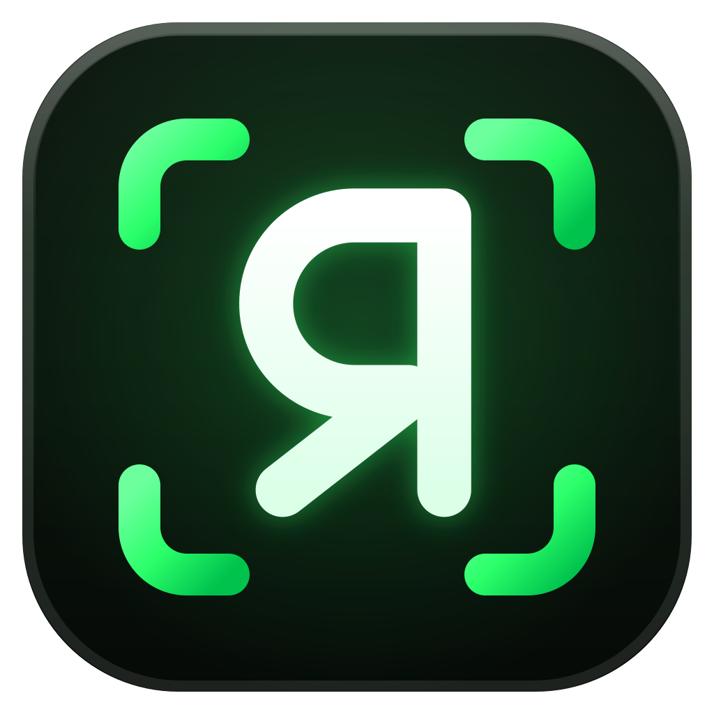
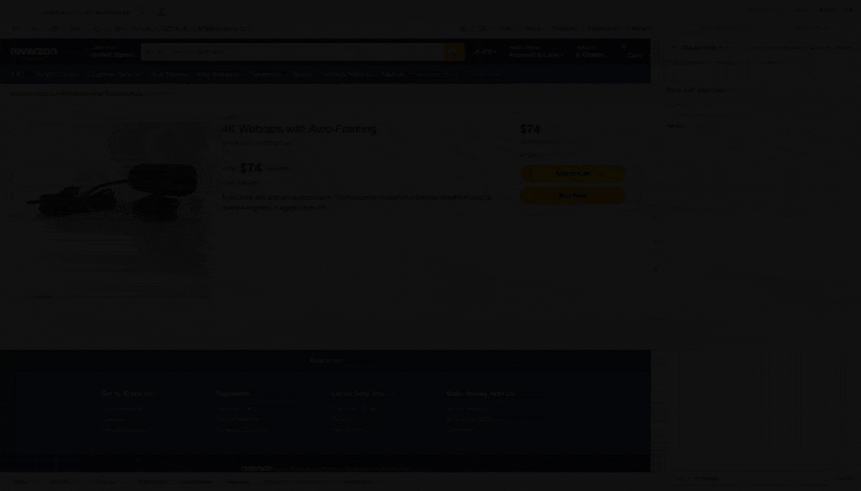
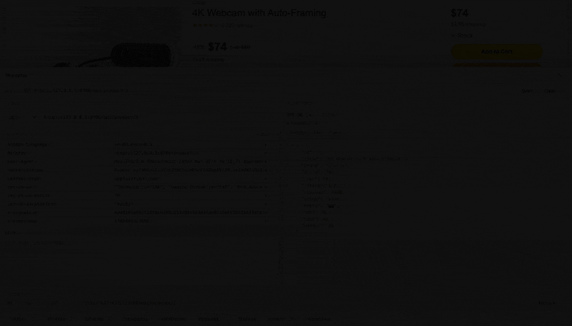
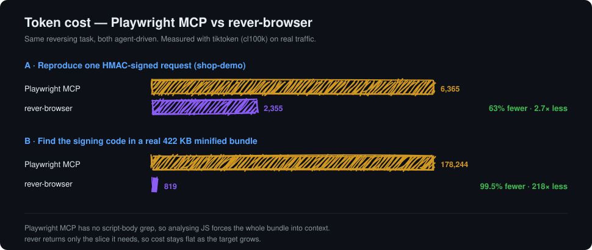

<div align="center">



# rever-browser

### API 리버스 엔지니어링을 위한 에이전트 네이티브 워크벤치.

[](./LICENSE)
[](https://github.com/greekr4/rever-browser/releases/latest)

**[⬇ macOS 다운로드](https://github.com/greekr4/rever-browser/releases/latest)** · **[⬇ Windows 다운로드](https://github.com/greekr4/rever-browser/releases/latest)**

[English](./README.md) · [소개](#rever-browser란) · [동작 방식](#동작-방식) · [기능](#기능) · [툴 구성](#툴-구성) · [시작하기](#시작하기) · [아키텍처](#아키텍처)

</div>

---

<div align="center">


</div>

## rever-browser란?

`rever-browser`는 **실제 Chromium 탭**과 **ACP 코딩 에이전트**(기본값 Claude Code)를 결합한 Electron 데스크톱 앱입니다. 임베드된 `<webview>`에서 대상 사이트를 브라우징하면 앱이 Chrome DevTools Protocol로 모든 네트워크 요청을 기록하고, 에이전트는 그 트래픽을 읽고 사이트의 JavaScript·WASM을 분석하며, 인프로세스 **MCP 툴 서버**(44개 도메인에 걸친 156개 툴)로 탭을 직접 조종합니다.

*"이 사이트는 어떤 요청을 보내지?"* 에서 *"서명된 API를 그대로 재현하는 원클릭 매크로"* 까지, 앱을 벗어나지 않고 갑니다. 그 과정은 한 단계씩, 지금 보고 있는 바로 그 탭에서 펼쳐집니다.

## 동작 방식

rever-browser에서 API를 리버싱하는 과정은 5단계 루프입니다. 에이전트가 스스로 이 루프를 돌며, 모든 단계가 UI에 보입니다.

| 단계 | 하는 일 | 예시 툴 |
|---|---|---|
| **캡처** | 실제 탭에서 대상을 브라우징. 모든 요청이 에이전트가 읽을 수 있는 실시간 트래픽 목록에 쌓임. | `list_requests`, `get_request`, `browser_navigate` |
| **분석** | JS 번들 grep, 난독화 해제, 소스맵 복원, Web Crypto 실시간 후킹, 불투명 바디 디코딩. | `grep_scripts`, `deobfuscate_script`, `crypto_trace_start`, `crypto_chain` |
| **재현** | 브라우저 자체 컨텍스트(쿠키·TLS·HTTP/2)로 요청을 재전송하고, 독립 실행될 때까지 변조. | `repeater_send`, `wasm_decompile`, `graphql_introspect` |
| **검증** | 결함을 실제로 증명. 마커 퍼징, 시크릿 스윕, XSS·경로순회·CRLF 프로브, 발견 기록. | `intruder_run`, `scan_secrets`, `path_probe`, `finding_add` |
| **자⁠동⁠화** | 동작하는 시퀀스를 결정적 매크로·CLI 명령·Python 클라이언트로 동결(루프에 LLM 없음). | `create_macro`, `cli_compile`, `export_python_client` |

<div align="center">



*요소를 클릭해 집고 → 스크린샷에 마크업 → 에이전트가 요청 서명 방식을 분석.*



*Repeater: 캡처한 요청을 바꾸고, 유출된 서명을 위조해 UI에는 안 나오는 필드를 드러냄.*


*매크로: 멀티스텝 플로를 에이전트에게 만들게 한 뒤, 저장하고 LLM 없이 재생.*

</div>

## 기능

- **실시간 트래픽 캡처**: 브라우징 탭의 모든 `Network.*` 이벤트를 링 버퍼에 기록합니다. 바디는 지연 로딩하고, 이미지/비디오/폰트/CSS는 건너뛰어 가볍게 유지합니다.
- **에이전트 선택**: 4개 프로바이더의 5개 에이전트. Claude Code·Codex는 로컬 ACP 바이너리로, Claude·OpenAI·Grok은 본인 키로 API를 직접 호출합니다. 모델은 통합 선택기에서 전환합니다.
- **ACP 또는 터미널 모드**: 구조화된 ACP 채팅을 쓰거나, 로컬 `claude` CLI가 도는 실제 터미널로 전환합니다. rever의 MCP 서버가 자동 연결되어 CLI 에이전트도 같은 브라우저·트래픽 툴을 씁니다.
- **브라우저 자동화**: 안정적 요소 ref를 가진 접근성 스냅샷, 그리고 클릭·호버·입력·스크롤·드래그·캔버스 드로잉·클립보드 붙여넣기·파일 업로드·키 입력·탭/뷰포트 제어·실시간 스크린샷.
- **번들·스크립트·WASM 분석**: 캡처된 JavaScript를 재다운로드 없이 grep·추출·번들러 탐지·`webcrack` 기반 난독화 해제, 소스맵에서 원본 TS/JS 복원, 안티봇 "VM" 번들 식별, `.wasm` 모듈을 WAT / C유사 / 풀 C로 디스어셈블. 요청 서명이 WebAssembly로 컴파일된 사각지대까지 커버합니다.
- **매크로 & 워크플로**: 툴 호출 시퀀스를 LLM 없이 결정적으로 재생되는 명명 매크로로 변환합니다. 인앱 Macro·Pipeline·Template 에디터로 원클릭 플로를 구성하고, 캡처한 요청은 바로 실행 가능한 CLI 명령이나 Python 클라이언트로 내보냅니다.
- **Grab & markup**: 아무 요소나 클릭해 스크린샷과 컨텍스트(셀렉터·ref·태그·텍스트)를 캡처합니다. 컨텍스트는 채팅으로 들어가고, 스크린샷은 사각형·화살표·자유 메모용 마크업 에디터로 열립니다.
- **프로필 & 쿠키 가져오기**: 명명된 영구/시크릿 프로필 각각이 독립된 쿠키/스토리지 공간입니다. Chrome·Edge·Brave·Arc·Chromium·Vivaldi·Firefox·Safari에서 로그인 세션을 가져올 수 있습니다.

## 토큰 효율

에이전트로 브라우저를 모는 건 작업이 컨텍스트 윈도에 들어맞을 때만 쓸모가 있습니다. rever는 에이전트가 **필요한 조각만** 툴로 질의합니다. 번들 전체가 아니라 grep 매치, 서명을 계산하는 코드가 아니라 캡처된 서명만 돌려받습니다. 그래서 같은 리버싱 과제를 [Playwright MCP](https://github.com/microsoft/playwright-mcp)(에이전트에게 브라우저를 주는 일반적 방법)로 할 때보다 토큰이 훨씬 적게 듭니다.

<div align="center">



</div>

| 과제 (동일 에이전트 흐름, 실측) | Playwright MCP | rever-browser | |
|---|--:|--:|:--|
| 서명 요청 1건 재현 (shop-demo) | 6,365 | 2,355 | **2.7배 적음** |
| 실제 422KB 번들에서 서명 코드 찾기 | 178,244 | 819 | **218배 적음** |

Playwright MCP엔 스크립트 바디 grep·crypto 후킹·Repeater가 없어 JS를 분석하려면 번들을 통째로 컨텍스트에 넣어야 합니다. rever는 대상이 커져도 비용이 거의 늘지 않습니다. tiktoken(`cl100k`)으로 실제 캡처 트래픽에서 측정했습니다.

## 툴 구성

**44개 도메인에 걸친 156개 MCP 툴**, 전부 에이전트(또는 셸)로 구동합니다. 카테고리별:

| 카테고리 | 다루는 것 |
|---|---|
| **트래픽 & 캡처** | 요청 목록/조회, 페이지네이션, 요청 diff, 바디 검사, 헤더 |
| **브라우저 제어** | 접근성 스냅샷, 클릭/입력/스크롤/드래그, DOM 편집, 다이얼로그, 대기, 스코프, 비전 판정 |
| **스크립트 & 번들** | 스크립트 grep/추출, 난독화 해제, 소스맵 복원, 안티봇 번들 탐지 |
| **WASM** | WAT / C로 디컴파일, 섹션·심볼 덤프, 문자열 grep, export→JS 교차참조 |
| **크립토 & 서명** | Web Crypto 실시간 후킹, HMAC/해시 계산, base64/hex/JWT 디코드 체인, protobuf/gRPC-web 디코드 |
| **구조 발견** | GraphQL 인트로스펙션, 요청 이니시에이터 콜스택, 리스너, 실행 추적, 서비스 워커, 콘솔 |
| **재전송 & 퍼징** | Repeater(실제 브라우저 컨텍스트), Intruder 마커 퍼저, 버스트, 페이로드 프로브 |
| **인터셉션 & 오버라이드** | 로그/차단/일시정지-수정 규칙, 로컬 응답·번들 오버라이드, 스크립트 주입 |
| **보안 감사** | 시크릿 스윕, 보안 헤더, XSS·경로순회·CRLF 프로브, 발견 로그, 인증 분석 |
| **스토리지 & 실시간** | 쿠키/스토리지 공간, WebSocket 프레임 캡처 |
| **자동화 & 내보내기** | 매크로, CLI 컴파일, HAR 1.2 내보내기, Python 클라이언트 내보내기 |

> 툴별 전체 레퍼런스는 `docs/`에 있고, 런타임에 MCP 엔드포인트로도 조회할 수 있습니다 (`python3 scripts/mcp-call.py --list`).

## 요구 사항

- [Bun](https://bun.sh): 패키지 매니저 (npm/pnpm 아님)
- Node.js: 아래 ACP 에이전트 바이너리용
- **PATH에 에이전트 바이너리** (ACP 에이전트만 필요하고, API 에이전트는 키만 있으면 됩니다):
  - `claude-agent-acp`: 기본 Claude Code 에이전트. `npm i -g @agentclientprotocol/claude-agent-acp`
  - `codex-acp`: Codex 에이전트. `npm i -g @agentclientprotocol/codex-acp`
- `webcrack` (선택): `deobfuscate_script` 툴을 활성화

## 시작하기

**그냥 쓰고 싶다면?** [최신 릴리스](https://github.com/greekr4/rever-browser/releases/latest)에서 빌드를 받고 에이전트 바이너리를 설치하세요 ([요구 사항](#요구-사항) 참고):

- **macOS**: 칩에 맞는 `.dmg` 선택(Apple Silicon은 `arm64`, Intel은 `x64`), 열어서 **Rever Browser**를 **응용 프로그램**으로 드래그.

  빌드가 서명되지 않아 Gatekeeper가 첫 실행을 막습니다. macOS가 *"손상되었습니다"* 라고 할 수 있는데, 다운로드가 깨진 게 아니라 격리 플래그입니다. 해제:

  ```bash
  xattr -dr com.apple.quarantine "/Applications/Rever Browser.app"
  ```

  또는 한 번 실행해 차단되게 둔 뒤 **시스템 설정 → 개인 정보 보호 및 보안 → 그래도 열기**. 설치당 한 번만 하면 됩니다.

- **Windows** (`-setup.exe`): 설치 프로그램 실행. 서명이 없어 SmartScreen이 경고하면 **추가 정보 → 실행**.

**소스에서 빌드:**

```bash
bun install      # 의존성 설치
bun run dev      # electron-vite 개발 시작 (main + preload + renderer, HMR)
```

기타 명령:

```bash
bun run build      # out/ 로 프로덕션 빌드
bun run typecheck  # tsconfig.node.json + tsconfig.web.json 타입 체크
bun run test       # vitest 단위 테스트
```

main/preload 프로세스 코드 변경을 HMR이 못 잡으면, Electron을 죽이고 `bun run dev`를 재실행:

```bash
pgrep -f "Electron|electron-vite" | xargs -r kill -9
```

## Claude Code에서 Rever 사용 (`/rever` 스킬)

Rever는 Claude Code 스킬을 제공해서, 어떤 `claude` 세션이든 실행 중인 Rever Browser를 조종하고 그 MCP 툴을 쓸 수 있습니다. 독립 레포 [greekr4/rever-browser-skill](https://github.com/greekr4/rever-browser-skill)로 제공되며, [`skills`](https://www.npmjs.com/package/skills) CLI로 설치합니다 (소스 체크아웃이 필요 없어 DMG/EXE 사용자도 됩니다):

```bash
npx skills add greekr4/rever-browser-skill --global --agent claude-code
```

Rever Browser 앱을 실행하면(시작 시 MCP 엔드포인트를 게시) 아무 `claude` 세션에서 `/rever`를 입력하세요. 스킬이 엔드포인트를 찾아 네이티브 MCP 툴로 등록하거나 번들된 `rever.py`로 툴을 직접 호출합니다. 엔드포인트 경로가 `~/Library/Application Support/` 아래에 있어 현재는 macOS만 지원합니다.

## 아키텍처

세 개의 Electron 프로세스가 엄격히 분리되며, 프로세스 간 작업은 전부 preload IPC를 거칩니다.

- **main** (`src/main/`): Node + Electron API. `<webview>`의 CDP 디버거를 소유하고, ACP 에이전트 프로세스를 띄우며, 에이전트가 콜백하는 인프로세스 HTTP MCP 서버를 호스팅합니다.
- **preload** (`src/preload/index.ts`): 렌더러에 노출되는 표면의 단일 진실 원천. `contextBridge`로 `window.rev`를 노출합니다.
- **renderer** (`src/renderer/src/`): React 19 + Vite. `<webview>` 태그와 채팅 UI를 호스팅합니다.

**트래픽 캡처:** `webview Network.* 이벤트 → main/chrome-cdp.ts → main/traffic-store.ts → renderer (TrafficList)`

**에이전트 루프:** `ChatPanel → ACPChatTransport → preload IPC → main/acp-session.ts → ACP 에이전트 자식 프로세스 → MCP 툴 → main/mcp/server.ts → 툴이 traffic-store 읽기 / CDP 조종`

MCP 서버는 첫 에이전트 스폰 시 지연 시작되며 임의의 localhost 포트에 바인딩됩니다. 설계 노트는 `docs/` 참고.

## 라이선스

[MIT](./LICENSE). 저작자 표시는 [NOTICE](./NOTICE) 참고.

의존성 트리의 모든 패키지는 허용적 라이선스(MIT, Apache-2.0, ISC, BSD)를 쓰며 카피레프트는 없습니다. 별도 프로세스로 호출되는 외부 도구(번들/배포 안 함): [claude-agent-acp](https://www.npmjs.com/package/@agentclientprotocol/claude-agent-acp) (Apache-2.0), [codex-acp](https://www.npmjs.com/package/@agentclientprotocol/codex-acp) (Apache-2.0), [webcrack](https://www.npmjs.com/package/webcrack) (MIT).

## 기여

버그 리포트, 기능 제안, PR 환영합니다. [CONTRIBUTING.md](./CONTRIBUTING.md) 참고.

## 책임 있는 사용

rever-browser는 **승인된** 보안 연구·API 디버깅·상호운용 작업을 위한 도구입니다. 본인이 소유했거나 테스트 권한을 명시적으로 받은 시스템을 대상으로 하세요. 권한 없는 API를 재현·변조·프로빙하는 것은 사이트 이용약관과 법을 위반할 수 있습니다. 사용에 대한 책임은 사용자에게 있습니다.
