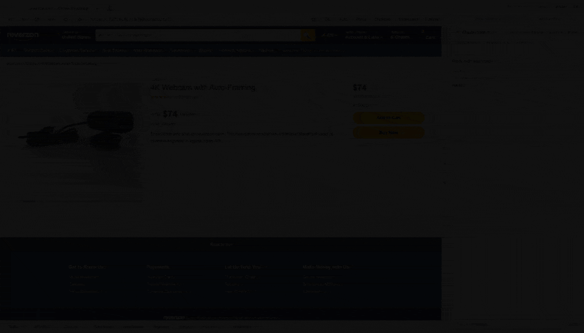
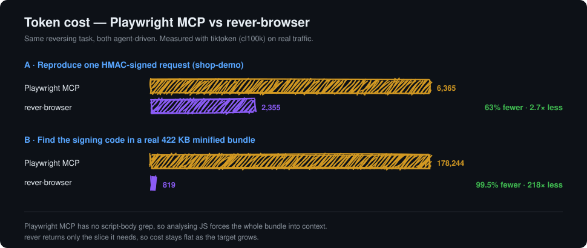

<div align="center">


### API 리버스 엔지니어링을 위한 에이전트 네이티브 워크벤치.

[](./LICENSE)
[](./.github/workflows/rust-ci.yml)

[English](./README.md)

</div>

> **개발 중입니다.** 2026-11-19에 Electron 앱을 Rust(GPUI + Servo)로 다시 만든 버전으로 바꿨습니다. 지금은 소스에서 빌드해야 하고 설치 파일은 아직 없습니다. 이 페이지의 GIF는 예전 Electron 빌드에서 녹화해서 실제 화면과 다릅니다.

---

<div align="center">


</div>

## rever-browser란?

`rever-browser`는 **Rust**로 만든 데스크톱 앱입니다([GPUI](https://github.com/zed-industries/gpui) 셸 + [Servo](https://servo.org) 엔진). **실제 브라우저 탭**과 **에이전트**(기본값 `claude` CLI)를 결합합니다. 임베드된 탭에서 대상 사이트를 브라우징하면 엔진의 네트워크 탭이 모든 요청을 기록하고, 에이전트는 그 트래픽을 읽고 사이트의 JavaScript·WASM을 분석하며, 인프로세스 **툴 서버**를 내장 `revb` CLI가 유닉스 소켓으로 호출해 탭을 직접 조종합니다(**178개 툴**, `revb list`로 실시간 집계).

*"이 사이트는 어떤 요청을 보내지?"* 에서 *"서명된 API를 그대로 재현하는 원클릭 매크로"* 까지, 앱을 벗어나지 않고 갑니다. 그 과정은 한 단계씩, 지금 보고 있는 바로 그 탭에서 펼쳐집니다.

## 동작 방식

rever-browser에서 API를 리버싱하는 과정은 5단계 루프입니다. 에이전트가 스스로 이 루프를 돌며, 모든 단계가 UI에 보입니다.

| 단계 | 하는 일 | 예시 툴 |
|---|---|---|
| **캡처** | 실제 탭에서 대상을 브라우징. 모든 요청이 에이전트가 읽을 수 있는 실시간 트래픽 목록에 쌓임. | `list_requests`, `get_request`, `browser_navigate` |
| **분석** | JS 번들 grep, 난독화 해제, 소스맵 복원, Web Crypto 실시간 후킹, 불투명 바디 디코딩. | `grep_scripts`, `deobfuscate_script`, `crypto_trace_start`, `crypto_chain` |
| **재현** | 브라우저 자체 컨텍스트(쿠키·TLS·HTTP/2)로 요청을 재전송하고, 독립 실행될 때까지 변조. | `repeater_send`, `wasm_decompile`, `graphql_introspect` |
| **검증** | 결함을 실제로 증명. 마커 퍼징, 시크릿 스윕, XSS·경로순회·CRLF 프로브, 발견 기록. | `intruder_run`, `scan_secrets`, `path_probe`, `finding_add` |
| **자⁠동⁠화** | 동작하는 시퀀스를 결정적 매크로·CLI 명령·Python 클라이언트로 동결(루프에 LLM 없음). | `create_macro`, `cli_compile`, `export_python_client` |

<div align="center">



*요소를 클릭해 집고 → 스크린샷에 마크업 → 에이전트가 요청 서명 방식을 분석.*


*Repeater: 캡처한 요청을 바꾸고, 유출된 서명을 위조해 UI에는 안 나오는 필드를 드러냄.*


*매크로: 멀티스텝 플로를 에이전트에게 만들게 한 뒤, 저장하고 LLM 없이 재생.*

</div>

---

## 레드팀 모드

타겟을 지정하면 공격적 점검 전체를 스스로 돌린다 — 한 단계씩 클릭해 줄 필요가 없다. **일회용 계정을 등록하고 로그인한 뒤**, 앱의 페이지와 API 호스트를 탐색하고, 그것들을 **병렬로 스캔하는 탭 그리드**로 연다. 워커마다 자기 탭을 몰며 — 클릭·입력·폼 제출 — 단발 프로브를 쏘고, 발견을 실시간으로 기록한다. 엔드포인트별 결정적 체크리스트가 어느 프로브를 어디서 돌릴지 정하므로, 커버리지가 모델의 기분에 좌우되지 않는다. 마지막엔 하나의 발견 보고서(OWASP식 카테고리·심각도·재현)를 작성한다.

<div align="center">


*레드팀: 타겟 하나 입력 → 등록·로그인하고 모든 페이지를 병렬 스캔. 탭마다 클릭·입력·실시간 발견.*

</div>

세 가지 강도:

- **Recon** — 관측·기록만, 프로브 없음.
- **Access** — 캡처된 요청을 변경 없이 재생 + 수동 보안/시크릿 점검.
- **Red Team** — 변형 단발 프로브(payload / path-traversal / CRLF), 숨은 경로 탐색(`.env`, `admin/`, `.git/HEAD`, 소스맵 …), 엔드포인트별 OWASP 체크리스트, 그리고 아래의 전수 UI 크롤까지 추가.

**전수 UI 크롤 + capture-not-send 펜스.** Red Team 강도에서 결정적 크롤러(`ui_crawl`)가 실행 가능한 모든 요소를 1회씩 누르고 그 클릭이 쏜 요청을 귀속시킨다 — 안 눌린 버튼·모달·다단계 폼 뒤의 API가 더는 안 보이지 않게 된다. 네트워크 계층 펜스가 안전을 보장한다: 본인 소유의 loopback / 랩 타겟에서는 *실제* 변조 — SQLi / NoSQLi, SSTI, 명령 주입, BOLA/IDOR, 깨진 인증 — 를 확인하므로 발견은 추측이 아니라 증명된다. 그 외의 곳에서는 서버 상태를 바꾸는 요청(`POST`/`PUT`/`PATCH`/`DELETE`, 또는 logout/revoke 경로)을 전송 대신 synthetic `204`로 응답한다. 엔드포인트 형태는 기록되고 서버는 변경되지 않는다. 일반 스캐너가 놓치는 클래스를 전용 프로브가 커버한다: `nosqli_probe`(Mongo/Neo4j 연산자 주입), `idor_probe`(교차 테넌트 객체 접근), `noauth_probe`(진짜 쿠키 없는 인증 테스트), `raw_http`(HAProxy `#` 경로 ACL 우회), 그리고 `grpc_call`과 `pickle_gadget`.

예시 — 레드팀 패널의 실시간 활동 로그와 크롤러의 버튼→API 맵:

```
00:03 대상 탐색 시작 — localhost:8080
00:11 6개 페이지 발견 → 탭 열기
00:18 병렬 검사 시작 (동시 6개)
00:24 [tab3] ui_crawl · elements: 9 — clicked 6, blocked-destructive 2, failed 0, navigated 1, noop 0
00:31 [tab3] IDOR on /api/orders/{id} — localhost:8080/orders
00:52 숨은 경로 탐색 (.env, admin, .git…)
01:20 보고서 작성
01:27 완료 — 발견 17건
```

```
element → API map (tab 3)
  "Load orders"  → GET  http://localhost:8080/api/orders
  "Open report"  → GET  http://localhost:8080/api/report
  "Subscribe"    → POST   http://localhost:8080/api/subscribe   [blocked]
  "Delete item"  → DELETE http://localhost:8080/api/items/1     [blocked]
```

보고서는 Markdown으로 저장(**Save .md**)하거나 후속 분석을 위해 채팅 패널로 바로 보낼 수 있다(**Send to chat**).

## 그외 기능들

- **실시간 트래픽 캡처**: 엔진 네트워크 스택 안의 탭이 브라우징 탭의 모든 요청을 링 버퍼에 기록합니다. WebSocket 연결과 프레임도 포함합니다. 바디는 항목과 함께 저장하고 이미지/비디오/폰트/CSS는 건너뛰어 가볍게 유지합니다.
- **에이전트는 Claude Code**: 로컬 `claude` CLI를 stream-json으로 구동하면서 모든 툴이 `revb` 셸 명령이라고 알려 줍니다. 그래서 에이전트는 Bash에서 탭을 몰고 트래픽을 읽습니다. 다른 에이전트는 아직 연결하지 않았습니다.
- **브라우저 자동화**: 안정적 요소 ref를 가진 접근성 스냅샷, 그리고 클릭·호버·입력·스크롤·드래그·캔버스 드로잉·클립보드 붙여넣기·파일 업로드·키 입력·탭/뷰포트 제어·실시간 스크린샷.
- **번들·스크립트·WASM 분석**: 캡처된 JavaScript를 재다운로드 없이 grep·추출·번들러 탐지·`webcrack` 기반 난독화 해제, 소스맵에서 원본 TS/JS 복원, 안티봇 "VM" 번들 식별, `.wasm` 모듈을 WAT / C유사 / 풀 C로 디스어셈블. 요청 서명이 WebAssembly로 컴파일된 사각지대까지 커버합니다.
- **매크로 & 워크플로**: 툴 호출 시퀀스를 LLM 없이 결정적으로 재생되는 명명 매크로로 변환합니다. 인앱 Macro·Pipeline·Template 에디터로 원클릭 플로를 구성하고, 캡처한 요청은 바로 실행 가능한 CLI 명령이나 Python 클라이언트로 내보냅니다.
- **Grab & markup**: 아무 요소나 클릭해 스크린샷과 컨텍스트(셀렉터·ref·태그·텍스트)를 캡처합니다. 컨텍스트는 채팅으로 들어가고, 스크린샷은 사각형·화살표·자유 메모용 마크업 에디터로 열립니다.
- **프로필 & 쿠키 가져오기**: 명명된 영구/시크릿 프로필 각각이 독립된 쿠키/스토리지 공간입니다. Chrome·Edge·Brave·Arc·Chromium·Vivaldi·Firefox·Safari에서 로그인 세션을 가져올 수 있습니다.

## 토큰 효율

에이전트로 브라우저를 모는 건 작업이 컨텍스트 윈도에 들어맞을 때만 쓸모가 있습니다. rever는 에이전트가 **필요한 조각만** 툴로 질의합니다. 번들 전체가 아니라 grep 매치, 서명을 계산하는 코드가 아니라 캡처된 서명만 돌려받습니다. 그래서 같은 리버싱 과제를 [Playwright MCP](https://github.com/microsoft/playwright-mcp)(에이전트에게 브라우저를 주는 일반적 방법)로 할 때보다 토큰이 훨씬 적게 듭니다.

<div align="center">



</div>

| 과제 (동일 에이전트 흐름, 실측) | Playwright MCP | rever-browser | |
|---|--:|--:|:--|
| 서명 요청 1건 재현 (shop-demo) | 6,365 | 2,355 | **2.7배 적음** |
| 실제 422KB 번들에서 서명 코드 찾기 | 178,244 | 819 | **218배 적음** |

Playwright MCP엔 스크립트 바디 grep·crypto 후킹·Repeater가 없어 JS를 분석하려면 번들을 통째로 컨텍스트에 넣어야 합니다. rever는 대상이 커져도 비용이 거의 늘지 않습니다. tiktoken(`cl100k`)으로 실제 캡처 트래픽에서 측정했습니다.

## 툴 구성

**178개 툴**, 에이전트가 `revb`로(또는 셸에서 직접) 구동합니다. 카테고리별:

| 카테고리 | 다루는 것 |
|---|---|
| **트래픽 & 캡처** | 요청 목록/조회, 페이지네이션, 요청 diff, 바디 검사, 헤더 |
| **브라우저 제어** | 접근성 스냅샷, 클릭/입력/스크롤/드래그, DOM 편집, 다이얼로그, 대기, 스코프, 비전 판정 |
| **스크립트 & 번들** | 스크립트 grep/추출, 난독화 해제, 소스맵 복원, 안티봇 번들 탐지 |
| **WASM** | WAT / C로 디컴파일, 섹션·심볼 덤프, 문자열 grep, export→JS 교차참조 |
| **크립토 & 서명** | Web Crypto 실시간 후킹, HMAC/해시 계산, base64/hex/JWT 디코드 체인, protobuf/gRPC-web 디코드 |
| **구조 발견** | GraphQL 인트로스펙션, 요청 이니시에이터 콜스택, 리스너, 실행 추적, 서비스 워커, 콘솔 |
| **재전송 & 퍼징** | Repeater(실제 브라우저 컨텍스트), Intruder 마커 퍼저, 버스트, 페이로드 프로브 |
| **인터셉션 & 오버라이드** | 로그/차단/일시정지-수정 규칙, 로컬 응답·번들 오버라이드, 스크립트 주입 |
| **보안 감사** | 시크릿 스윕, 보안 헤더, XSS·경로순회·CRLF 프로브, 발견 로그, 인증 분석 |
| **스토리지 & 실시간** | 쿠키/스토리지 공간, WebSocket 프레임 캡처 |
| **자동화 & 내보내기** | 매크로, CLI 컴파일, HAR 1.2 내보내기, Python 클라이언트 내보내기 |

> 툴별 전체 레퍼런스는 `docs/`에 있고, 런타임에 조회할 수도 있습니다 (`node bin/revb.mjs list`. 도구 하나의 설명과 인자 스키마는 `node bin/revb.mjs describe <tool>`).

## 요구 사항

- Rust 툴체인 (stable)
- PATH의 `claude` (Claude Code CLI) — 내장 에이전트가 이 위에서 동작
- `webcrack` (선택) — `deobfuscate_script` 툴 활성화

## 시작하기

**소스에서 빌드** (Rust 앱의 패키지 릴리스는 아직 없습니다 — 예전 다운로드는 은퇴한 Electron 빌드):

```bash
./scripts/apply-rust-patches.sh   # 벤더 크레이트 패치 (최초 1회)
cargo run -p rever -- <url>       # 빌드 후 실행
```

그 외 명령:

```bash
cargo test --workspace     # 전 크레이트 단위 테스트
cargo run -p port-harness  # 포트 인벤토리 + 동작 검사
```

## Claude Code에서 Rever 사용 (`/rever` 스킬)

Rever는 Claude Code 스킬을 제공해서, 어떤 `claude` 세션이든 실행 중인 Rever Browser를 조종하고 그 툴을 쓸 수 있습니다. 독립 레포 [greekr4/rever-browser-skill](https://github.com/greekr4/rever-browser-skill)로 제공되며, [`skills`](https://www.npmjs.com/package/skills) CLI로 설치합니다:

```bash
npx skills add greekr4/rever-browser-skill --global --agent claude-code
```

Rever Browser 앱을 실행하면(시작 시 컨트롤 소켓을 게시) 아무 `claude` 세션에서 `/rever`를 입력하세요. 스킬이 소켓을 찾아 `revb`로 툴을 호출합니다(Node가 없는 환경에서는 번들된 `rever.py`). 엔드포인트 경로가 `~/Library/Application Support/` 아래에 있어 현재는 macOS만 지원합니다.

## 아키텍처

하나의 Rust 워크스페이스입니다. `rever` 크레이트가 앱 본체(GPUI 창 + Servo 탭)이며, 각 관심사는 고유 크레이트(`rever-core`, `rever-control-server`, `rever-tools-*`, `rever-ui-*` 등)에 살아 있습니다.

- **엔진.** Servo를 패치해 벤더합니다(`patches/servo-net@0.8.0.patch`). 네트워크 탭이 모든 요청·응답 바디·WebSocket 프레임을 인프로세스로 전달합니다.
- **컨트롤 서버.** `rever-control-server`가 툴 레지스트리를 유닉스 소켓으로 서빙합니다(경로·토큰·pid를 `control-endpoint.json`에 공개). 에이전트와 외부 클라이언트가 같은 툴을 씁니다.
- **에이전트.** `claude` CLI를 stream-json으로 구동합니다. 권한 요청은 위험 툴 이름이 없는 단일 `revb` 명령만 자동 승인되며, 캡처-노전송 펜스가 최후의 안전망입니다.

**트래픽 캡처:** 엔진 탭 → `TrafficStore`(링 버퍼) → 패널과 툴이 함께 읽습니다.

**에이전트 루프:** 채팅 → `AgentSession`(claude CLI) → `revb` → 컨트롤 소켓 → 탭/스토어/페이지 입력.

설계 노트는 `docs/`에 있습니다.

## 라이선스

[MIT](./LICENSE). 저작자 표시는 [NOTICE](./NOTICE) 참고.

의존성 트리의 모든 패키지는 허용적 라이선스(MIT, Apache-2.0, ISC, BSD)를 쓰며 카피레프트는 없습니다. 별도 프로세스로 호출되는 외부 도구(번들/배포 안 함): [webcrack](https://www.npmjs.com/package/webcrack) (MIT).

## 기여

버그 리포트, 기능 제안, PR 환영합니다. [CONTRIBUTING.md](./CONTRIBUTING.md) 참고.

## 책임 있는 사용

rever-browser는 **승인된** 보안 연구·API 디버깅·상호운용 작업을 위한 도구입니다. 본인이 소유했거나 테스트 권한을 명시적으로 받은 시스템을 대상으로 하세요. 권한 없는 API를 재현·변조·프로빙하는 것은 사이트 이용약관과 법을 위반할 수 있습니다. 사용에 대한 책임은 사용자에게 있습니다.
