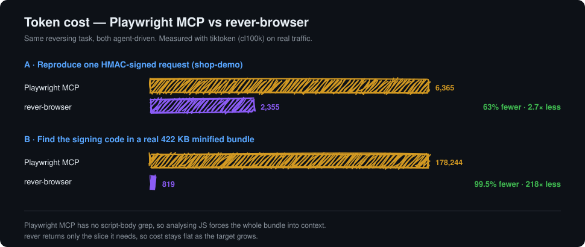

<div align="center">


### An agent-native workbench for API reverse engineering.

[](./LICENSE)
[](./.github/workflows/rust-ci.yml)

[한국어](./README.ko.md)

</div>

> **Work in progress.** The Rust rewrite (GPUI + Servo) replaced the Electron app on 2026-11-19. It builds from source only and has no installer yet. The GIFs on this page were recorded in the earlier Electron build, so the UI you get looks different.

---

<div align="center">


</div>

## What is rever-browser?

`rever-browser` is a desktop app built in **Rust** (a [GPUI](https://github.com/zed-industries/gpui) shell around the [Servo](https://servo.org) engine) that pairs a **real browser tab** with an **agent** (the `claude` CLI by default). You browse a target site in the embedded tab; the engine's network tap records every request, and the agent reads that traffic, analyzes the site's JavaScript and WASM, and drives the tab itself through an in-process **tool server** that the bundled `revb` CLI reaches over a Unix socket — **178 tools** (counted live by `revb list`).

It takes you from *"what requests does this site make?"* to *"here's a one-click macro that reproduces its signed API"* without ever leaving the app, and you watch the agent do it step by step in the tab you're already looking at.

## How it works

Reversing an API in rever-browser is a five-phase loop. The agent moves through it on its own, and every step is visible in the UI.

| Phase | What happens | Example tools |
|---|---|---|
| **Capture** | Browse the target in the real tab. Every request lands in a live traffic list the agent can read. | `list_requests`, `get_request`, `browser_navigate` |
| **Analyze** | Grep the JS bundles, deobfuscate, read source maps, hook Web Crypto live, decode opaque bodies. | `grep_scripts`, `deobfuscate_script`, `crypto_trace_start`, `crypto_chain` |
| **Reproduce** | Replay a request through the browser's own context (its cookies, TLS, HTTP/2) and tamper with it until it works standalone. | `repeater_send`, `wasm_decompile`, `graphql_introspect` |
| **Verify** | Prove the flaw live: fuzz a marker, sweep for secrets, run XSS / path-traversal / CRLF probes, log findings. | `intruder_run`, `scan_secrets`, `path_probe`, `finding_add` |
| **Automate** | Freeze the working sequence into a deterministic macro, a CLI command, or a Python client, with no LLM in the loop. | `create_macro`, `cli_compile`, `export_python_client` |

<div align="center">


*Grab any element → mark up the screenshot → the agent analyzes how the request is signed.*


*Repeater: change a captured request, forge the leaked signature, and surface a field the UI never shows.*


*Macros: ask the agent to build a multi-step flow, then save it and replay it deterministically with no LLM in the loop.*

</div>

---

## Red Team mode

Point it at a target and it runs the whole offensive sweep on its own — no clicking through it step by step. It **registers a throwaway account and logs in**, discovers the app's pages and API hosts, then opens them as a **grid of tabs it scans in parallel**: each worker drives its own tab — clicking, typing, submitting forms — fires single-shot probes, and logs findings live. A deterministic per-endpoint checklist decides which probe runs where, so coverage doesn't depend on the model's mood. At the end it writes a single findings report (OWASP-style categories, severity, repro).

<div align="center">


*Red Team: one target in → register, log in, and scan every page in parallel, with per-tab clicking, typing, and live findings.*

</div>

Three intensities:

- **Recon** — observe and record only, no probes.
- **Access** — replay captured requests unchanged + passive security/secret inspection.
- **Red Team** — adds single-shot mutated probes (payload / path-traversal / CRLF), hidden-path discovery (`.env`, `admin/`, `.git/HEAD`, source maps…), an OWASP category checklist per endpoint, and the exhaustive UI crawl below.

**Exhaustive UI crawl + capture-not-send fence.** At Red Team intensity a deterministic crawler (`ui_crawl`) clicks *every* actionable element once and attributes the request each one fired — so APIs behind unclicked buttons, modals and multi-step forms stop being invisible. A network-layer fence makes it safe: on your own loopback / lab targets it confirms *real* mutations — SQLi / NoSQLi, SSTI, command injection, BOLA/IDOR, broken auth — so a finding is proven, not guessed; anywhere else, any request that would change server state (`POST`/`PUT`/`PATCH`/`DELETE`, or a logout/revoke path) is answered with a synthetic `204` instead of being sent. The endpoint's shape is recorded; the server is never mutated. Purpose-built probes cover the classes a generic scanner misses: `nosqli_probe` (Mongo/Neo4j operator injection), `idor_probe` (cross-tenant object access), `noauth_probe` (a genuinely cookie-less auth test), `raw_http` (HAProxy `#` path-ACL bypass), plus `grpc_call` and `pickle_gadget`.

Example — the Red Team panel's live activity log and the crawler's button→API map:

```
00:03 Target discovery started — localhost:8080
00:11 6 pages found → opening tabs
00:18 Parallel inspection (6 at once)
00:24 [tab3] ui_crawl · elements: 9 — clicked 6, blocked-destructive 2, failed 0, navigated 1, noop 0
00:31 [tab3] IDOR on /api/orders/{id} — localhost:8080/orders
00:52 Hidden-path discovery (.env, admin, .git…)
01:20 Writing report
01:27 Done — 17 findings
```

```
element → API map (tab 3)
  "Load orders"  → GET  http://localhost:8080/api/orders
  "Open report"  → GET  http://localhost:8080/api/report
  "Subscribe"    → POST   http://localhost:8080/api/subscribe   [blocked]
  "Delete item"  → DELETE http://localhost:8080/api/items/1     [blocked]
```

The report exports to Markdown (**Save .md**) or pipes straight into the chat panel (**Send to chat**) for follow-up analysis.

## More features

- **Live traffic capture.** A tap inside the engine's network stack records every request the browsed tab makes into a ring buffer — including WebSocket connections and frames. Bodies are stored with the entry, and image/video/font/CSS payloads are skipped to keep it lean.
- **Claude Code as the agent.** The app runs your local `claude` CLI over stream-json and tells it that every tool is a `revb` shell command, so the agent drives the tab and reads traffic from Bash. Other agents are not wired up yet.
- **Browser automation.** Accessibility snapshots with stable element refs, plus click, hover, type, scroll, drag, canvas draw, clipboard paste, file upload, key press, tab and viewport control, and live screenshots.
- **Bundle, script & WASM analysis.** Grep, extract, detect the bundler, and deobfuscate captured JavaScript (no re-download) with a `webcrack`-backed deobfuscator; recover original TS/JS from source maps; flag anti-bot "VM" bundles; and disassemble `.wasm` modules to WAT, C-like, or full C. That last part closes the blind spot where request signing is compiled into WebAssembly.
- **Macros & workflows.** Turn a sequence of tool calls into a named macro that replays deterministically with no LLM in the loop. In-app Macro, Pipeline, and Template editors build these one-click flows, and any captured request exports to a ready-to-run CLI command or Python client.
- **Grab & markup.** Click any element to capture its screenshot and context (selector, ref, tag, text). The context drops into the chat and the screenshot opens in a markup editor for rectangles, arrows, and freehand notes.
- **Profiles & cookie import.** Named persistent or incognito profiles, each an isolated cookie/storage jar. Pull a logged-in session from Chrome, Edge, Brave, Arc, Chromium, Vivaldi, Firefox, or Safari.

## Token efficiency

An agent-driven browser is only useful if the work fits in a context window. rever's tools hand back **only the slice the agent needs**: a grep match instead of a whole bundle, a captured signature instead of the code that computes it. So a reversing task costs far fewer tokens than the same task run through [Playwright MCP](https://github.com/microsoft/playwright-mcp), the usual way to give an agent a browser.

<div align="center">



</div>

| Task (measured, same agent flow) | Playwright MCP | rever-browser | |
|---|--:|--:|:--|
| Reproduce one signed request (shop-demo) | 6,365 | 2,355 | **2.7× less** |
| Find signing code in a real 422 KB bundle | 178,244 | 819 | **218× less** |

Playwright MCP has no script-body grep, crypto hooks, or Repeater, so analyzing JavaScript forces the whole bundle into context. rever's cost stays flat as the target grows. Counted with tiktoken (`cl100k`) on real captured traffic.

## Tool surface

**178 tools**, driven by the agent through `revb` (or by hand from a shell). By category:

| Category | What it covers |
|---|---|
| **Traffic & capture** | List/get requests, pagination, request diffing, body inspection, headers |
| **Browser control** | Accessibility snapshots, click/type/scroll/drag, DOM edits, dialogs, waits, scope, vision judge |
| **Scripts & bundles** | Grep/extract scripts, deobfuscate, source-map recovery, anti-bot bundle detection |
| **WASM** | Decompile to WAT / C, dump sections & symbols, grep strings, xref exports to JS |
| **Crypto & signatures** | Live Web Crypto hooks, HMAC/hash compute, base64/hex/JWT decode chains, protobuf/gRPC-web decode |
| **Structure discovery** | GraphQL introspection, request-initiator call stacks, listeners, exec trace, service workers, console |
| **Replay & fuzz** | Repeater (real browser context), Intruder marker fuzzer, bursts, payload probes |
| **Interception & overrides** | Log/block/pause-and-modify rules, local response & bundle overrides, script injection |
| **Security audit** | Secret sweep, security headers, XSS / path-traversal / CRLF probes, findings log, auth analysis |
| **Storage & realtime** | Cookie/storage jars, WebSocket frame capture |
| **Automation & export** | Macros, CLI compile, HAR 1.2 export, Python client export |

> A full per-tool reference lives in `docs/` and is also discoverable at runtime with `node bin/revb.mjs list` (every tool) or `node bin/revb.mjs describe <tool>` (one tool's description and input schema).

## Requirements

- A Rust toolchain (stable)
- `claude` (the Claude Code CLI) on your PATH — the built-in agent runs on it
- `webcrack` on your PATH (optional) to enable the `deobfuscate_script` tool

## Getting started

**Building from source** (there is no packaged release of the Rust app yet — the prebuilt downloads were the retired Electron build):

```bash
./scripts/apply-rust-patches.sh   # fetch + patch the vendored crates (first run)
cargo run -p rever -- <url>       # build and launch the app
```

Other commands:

```bash
cargo test --workspace   # every crate's unit tests
cargo run -p port-harness  # inventory + behavior checks of the port
```

## Use Rever from Claude Code (the `/rever` skill)

Rever ships a Claude Code skill so any `claude` session can drive a running Rever Browser and use its tools. It lives in its own repo, [greekr4/rever-browser-skill](https://github.com/greekr4/rever-browser-skill), installable with the [`skills`](https://www.npmjs.com/package/skills) CLI:

```bash
npx skills add greekr4/rever-browser-skill --global --agent claude-code
```

Launch the Rever Browser app (it publishes a control socket on startup), then in any `claude` session type `/rever`. The skill resolves the socket and calls the tools through `revb` (or the bundled `rever.py` where Node is unavailable). It's macOS only for now, since the endpoint path lives under `~/Library/Application Support/`.

## Architecture

One Rust workspace. The `rever` crate is the app — a GPUI window hosting Servo tabs — and every concern lives in its own crate (`rever-core`, `rever-control-server`, `rever-tools-*`, `rever-ui-*`, …).

- **Engine.** Servo is vendored with a patch (`patches/servo-net@0.8.0.patch`) that adds a network tap: every request, response body, and WebSocket frame flows to the embedder in-process.
- **Control server.** `rever-control-server` serves the tool registry over a Unix socket (its path, token and pid are published to `control-endpoint.json`), so the agent — and any outside client — drives the same tools.
- **Agent.** The `claude` CLI runs over stream-json; its permission requests are auto-approved only for a single `revb` command that names no risky tool, with a capture-not-send fence as the safety net.

**Traffic capture:** engine tap → `TrafficStore` (ring buffer) → panels and tools alike.

**Agent loop:** chat → `AgentSession` (claude CLI) → `revb` → control socket → tap/traffic store / page input.

See `docs/` for design notes.

## License

[MIT](./LICENSE). See [NOTICE](./NOTICE) for attribution.

Every package in the dependency tree uses a permissive license (MIT, Apache-2.0, ISC, or BSD), none copyleft. External tool invoked as a separate process (not bundled): [webcrack](https://www.npmjs.com/package/webcrack) (MIT).

## Contributing

Bug reports, feature suggestions, and PRs are welcome. See [CONTRIBUTING.md](./CONTRIBUTING.md).

## Responsible use

rever-browser is a tool for **authorized** security research, API debugging, and interoperability work: testing systems you own or have explicit permission to test. Reproducing, tampering with, or probing an API you are not authorized to touch may violate a site's terms of service and the law. You are responsible for how you use it.
